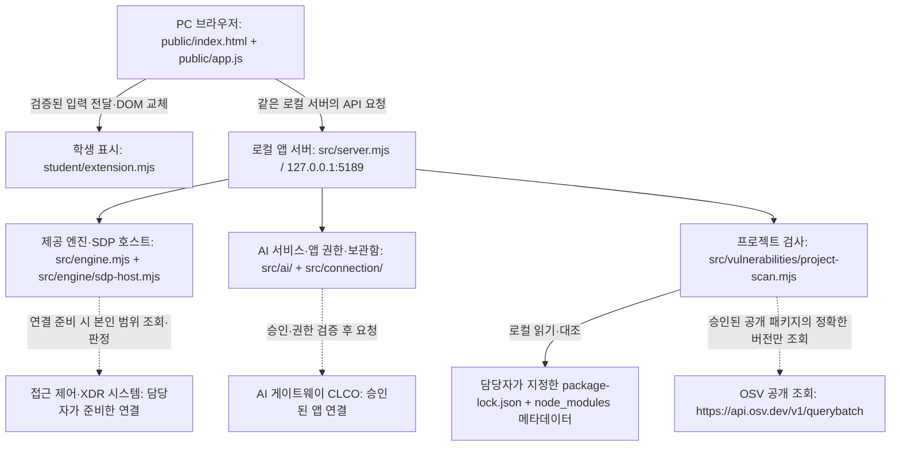

# 케셰브 학생 실행 설명서 · 21단계

작성·확인일: 2026-10-26, 한국 시각. 이 문서는 현재 저장소의 파일과 로컬 실행 증거를 설명하며 공식 통과 기록은 아닙니다. 제공 문서와 기존 코드는 보존합니다.

## 목적과 범위

직원 본인의 계정·기기·현재 세션, 선택한 업무 앱의 판정, 최근 보안 기록과 저장된 XDR 경보를 표시합니다. AI 연결 점검과 사건 설명을 구분하고, 조치의 준비·사람 확인·ACK·효과 관측 및 패키지 취약점 조회 상태를 각각 표시합니다. 학생 함수는 전달받은 자료를 그리며 실제 보안 집행기를 구현하지 않습니다.

기본 시작은 연결 없음입니다. 기기 상태 표시는 악성코드 검사·치료가 아니며, OSV의 `none_found`도 앱 전체의 안전 보장이 아닙니다. 최근 기록은 본인 범위 최대 40건, 세션은 현재 검증된 연결 하나입니다. 실제 조치 연동은 준비되지 않아 학생 계정의 집행 결과는 기다림(UNV)입니다.

## 프로그램과 확인한 버전

| 항목 | 계약·확인 결과 |
|---|---|
| OS | Windows에서 PowerShell 실행 확인. macOS·Linux 실행은 미확인 |
| Node.js | `on-client/package.json` engines는 `24.19.0`. 제공 실행 도구는 주 버전 22~24를 허용. 이번 실제 실행은 **v24.22.1**이며 기준 버전과 다름 |
| 기본 PATH의 Node.js | v25.9.0을 확인. 제공 실행 도구의 허용 범위를 벗어나 아래처럼 현재 창에서 확인된 24 버전을 선택 |
| PowerShell | 명령 도구는 7.6.5, 제공 도구가 실행된 `powershell.exe`는 5.1.26100.9711 |
| Git | 2.45.1.windows.1. 실행에 필수는 아니며 이력·커밋 확인에 사용 |
| npm | 기본 PATH에서 11.12.1 확인. 이 npm과 Node 24 조합의 실행은 미확인. 아래 주 실행 절차는 npm을 사용하지 않음 |
| 브라우저 | PC 브라우저 필요. 이번 단계에서 브라우저 종류·버전·DOM 조작은 미확인. HTTP 응답 확인과 구분 |

`package.json`에 외부 npm 의존성이 없고 `package-lock.json`도 없습니다. 이번 문서 작업에서 `npm install`, 패키지 변경, 잠금 파일 생성은 하지 않았습니다. 실제 취약점 조회 대상 프로젝트·허용 목록은 담당자가 준비하며 학생이 임의 지정하지 않습니다.

## 작업 위치와 파일 구조

현재 확인한 Git 최상위 폴더:

```text
C:\Users\김재현\Documents\Codex\2026-10-16\use-my-oct-16-notion-page\work\aleph-defense-starter
```

이 경로는 이 PC의 확인된 작업 사본입니다. 다른 PC에서는 본인이 받은 저장소의 실제 경로로 바꿉니다. 예전 1~12단계 파일은 Git 최상위에 남아 있으므로 삭제하거나 이 단계의 실행 명령과 혼동하지 않습니다.

```text
aleph-defense-starter/             # Git 최상위: 커밋·제출 기준
  AGENTS.md                       # 기존 작업 규칙
  README.md                       # 기존 단계 문서: 보존
  on-client/                      # 케셰브 앱 실행 위치
    package.json                  # start / demo / check
    README.md                     # 제공 안내 + 학생 안내 링크
    docs/STUDENT_RUNBOOK.md       # 이 학생 문서
    tools/start-alekov.ps1         # 제공 실행 도구
    public/index.html             # 제공 세 메뉴·버튼
    public/app.js                 # 제공 요청·취소·학생 DOM 교체
    public/vulnerabilities-view.mjs # 제공 조회 결과 형식 검증
    student/extension.mjs         # 13~20단계 학생 표시 함수
    student/engine-adapter.mjs    # 제공 호스트 기능 연결 경계: 이번 작업 미수정
    src/server.mjs               # 로컬 HTTP 서버·API
    src/engine.mjs               # 기본 미연결·예제 엔진
    src/engine/sdp-host.mjs       # 본인 범위 접근 제어·XDR 연결
    src/connection/              # 제공 계정·앱 연결 처리
    src/ai/                      # 설명 검증·앱 권한·자격 보관
    src/actions/                 # 제공 조치 준비·전달·결과 처리
    src/vulnerabilities/         # lock/설치 메타데이터 대조·OSV 조회
    vendor/clco-http.mjs         # 제공 AI 전송 코드
```

## PowerShell에서 실행하기

1. 파일 탐색기에서 **on-client** 폴더를 열고 주소 표시줄에 `powershell`을 입력합니다. 또는 새 PowerShell에서 아래처럼 이동합니다.

```powershell
Set-Location -LiteralPath 'C:\Users\김재현\Documents\Codex\2026-10-16\use-my-oct-16-notion-page\work\aleph-defense-starter\on-client'
Get-Location
Test-Path .\package.json
Test-Path .\src\server.mjs
Test-Path .\tools\start-alekov.ps1
node --version
```

파일 확인 세 개가 `True`이고 Node 버전이 기준·허용 범위에 맞는지 확인합니다. 이번 PC는 기본 Node가 25이므로, 실제 존재와 버전을 확인한 아래 실행 파일을 현재 창에서만 선택했습니다. 다른 PC에 이 경로가 없으면 복사해서 실행하지 말고 담당자에게 기준 Node 환경을 확인합니다.

```powershell
$nodeBinForKeshev = 'C:\Users\kjh\.cache\codex-runtimes\codex-primary-runtime\dependencies\node\bin'
& "$nodeBinForKeshev\node.exe" --version
$env:Path = "$nodeBinForKeshev;$env:Path"
node --version
```

이 PC의 해당 파일은 `v24.22.1`입니다. 전역 PATH나 인증 설정을 바꾸지 않습니다.

2. 앱 폴더에서 제공 실행 도구를 실행합니다.

```powershell
powershell -NoProfile -ExecutionPolicy Bypass -File .\tools\start-alekov.ps1
```

기본 브라우저 주소는 `http://127.0.0.1:5189/`입니다. 이 옵션은 해당 PowerShell 프로세스에 적용되며 전역 실행 정책 변경 명령은 아닙니다. 실행 도구는 Node·폴더·포트를 확인하고 다른 서버를 종료하지 않습니다.

정상 시작 신호는 `케셰브가 켜졌습니다. 브라우저에서 ... 을 여세요.`와 `서버가 응답한 것만 확인했습니다. AI 연결 상태는 화면에서 따로 확인해 주세요.`입니다. 이는 로컬 HTTP 응답 확인이며 실제 계정·AI 연결 성공이 아닙니다. `src/server.mjs`가 출력하는 `케셰브 연결 확인: ...`도 운영 연결 성공 증거로 쓰지 않습니다.

포트 사용 중이면 기존 작업을 보존하고 다른 포트를 명시합니다.

```powershell
powershell -NoProfile -ExecutionPolicy Bypass -File .\tools\start-alekov.ps1 -Port 5197
```

이때 주소는 `http://127.0.0.1:5197/`입니다. 이번 점검은 5197을 사용했습니다. 브라우저를 직접 열어 보호 현황·업무 앱·보안 기록이 나타나는지 확인하는 것은 별도 절차입니다.

3. 종료는 실행한 창에서 `Ctrl+C`를 누릅니다. 해당 주소에 다시 접근해 응답이 중지됐는지 확인합니다. 재실행은 같은 앱 폴더에서 같은 실행 명령을 다시 사용합니다. 이번 단계에서 전경 `Ctrl+C`·사용자 창에서 재실행은 직접 확인하지 않았습니다.

배경 실행이 필요한 경우 제공 도구의 `-Background` 옵션을 사용합니다. 도구가 출력한 프로세스 번호의 **본인이 시작한 node만** 작업 관리자에서 종료합니다. 이번 점검에서는 `-Port 5197 -Background`로 실행하고 출력된 시험 프로세스만 종료했습니다. 다른 Node 프로세스를 일괄 종료하지 않습니다.

### package.json의 다른 명령

| 앱 폴더 명령 | 코드상 동작 | 이번 확인 |
|---|---|---|
| `npm start` | `node src/server.mjs`, 기본 5189·미연결 | 스크립트 원문 대조. npm 경유 실행은 미확인 |
| `npm run demo` | `node src/server.mjs --demo`, 예제 자료 | 스크립트 원문 대조. 이번 단계 실행은 미확인·실제 계정 자료 아님 |
| `npm run check` | `node --check student/extension.mjs` | 같은 Node 문법 검사를 직접 실행해 통과. npm 경유는 미확인 |

이번 학생 문서의 정확한 문법 확인 명령은 Node 24를 선택한 앱 폴더에서 `node --check .\student\extension.mjs`입니다. 문법 검사는 화면·실제 API 연결·공식 통과 인증이 아닙니다.

## 글로 쓴 시스템 구성도



실선은 로컬 모듈의 관계이고 점선은 연결·승인·설정이 갖춰져야 이용되는 외부 경로입니다. 기본 실행에서 점선 경로의 실제 운영 연결을 확인한 것이 아닙니다. 포트를 바꾸면 브라우저와 로컬 앱 주소도 함께 바뀝니다.

브라우저는 로컬 서버에만 앱 API 요청을 보냅니다. 제공 `public/app.js`는 응답을 검증하고 학생 함수에 상태와 안전한 자료를 전달합니다. 학생 함수는 새 DOM을 반환하고 제공 화면이 이전 요소를 교체합니다. 브라우저나 학생 표시 함수가 AI 게이트웨이·SDP·OSV에 직접 요청하는 구조가 아닙니다.

서버는 어댑터와 호스트를 통해 본인 범위 접근 판정·기록을 조회하며, AI 설명은 별도 서비스가 현재 사건의 근거·규칙을 읽고 모델 응답을 검증합니다. 모델 목록 점검과 사건 설명 생성은 별도 요청입니다. 조치는 제공 서버의 준비·사람 확인·전달·결과 조회 경로가 담당하며 ACK를 효과로 취급하지 않습니다. 학생 `renderAction`은 실행기를 호출하지 않습니다.

외부 SDP·AI 게이트웨이의 실제 주소·자격은 이 프로젝트에서 확인하지 않았으므로 만들지 않았습니다. 공개 OSV 주소는 제공 소스의 상수와 대조했습니다. 개발을 돕는 Workbench AI, 앱 안 사건 설명 AI, ALEPH 공식 과제 판정 AI는 서로 다른 역할입니다. 이 문서는 모델 호출이나 제출을 실행하지 않습니다.

## 제공 부분과 학생 구현

모든 함수의 소유 파일은 `student/extension.mjs`이며 `createStudentView`가 아래 메서드를 반환합니다. API 상태값·속성 이름은 입력 계약을 유지합니다.

| 학생 함수·단계 | 입력·구현 | 확인 범위 |
|---|---|---|
| `renderIdentity` · 13 | `{me,devices,sessions}`의 상태·모드·사용자/기기/세션 구분 | 기존 모의 검사 기록. 이번 단계는 원문 대조 |
| `renderDecision` · 14 | `{status,mode,data,error,appId}`, allow/deny/challenge/unknown·이유·시각 | 기존 모의 검사 기록. 실제 정책 변경 없음 |
| `renderEvents` · 15 | 기록 배열 복사·최신순·세 필터·근거/규칙/세 상태 상세 | 기존 모의 검사 기록. 본인 최근 40건 범위 |
| `renderStatus` · 16 | 기기·세션·알림·제공 diagnostics, 안전한 여섯 필드만 도움정보 복사 | 기존 모의 검사 기록. 실제 클립보드 조작은 미확인 |
| `renderAiConnection` · 17 | 점검 상태·test/verified·모델 수·시각, 설명 실행과 분리 | 기존 모의 검사 기록. 실제 승인·모델 응답은 미확인 |
| `renderExplanation` · 18 | 현재 사건 근거 ID/글·규칙·세 상태·AI 제안·미실행·사람 확인 | 모의 검사. 실제 사건 설명 호출은 미확인 |
| `renderAction` · 19 | 사건·대상·요청·receipt·상태, succeeded + effectApplied true만 효과 확인 | 모의 검사. 실제 집행·결과 재조회는 UNV |
| `renderVulnerabilities` · 20 | 전체/행 상태·정확한 버전·출처·시각·부분 취약점 보존 | 모의 검사. 실제 설치 버전·OSV 조회는 미확인 |

`public/app.js`·`src/server.mjs`·`src/ai/`·`src/actions/`·`src/vulnerabilities/`와 실행 도구는 제공 코드입니다. 요청·취소 세대 관리·인증·연동·조치 티켓은 제공 영역에 있고, 학생 함수가 새 인증 정보나 요청 버튼을 만들지 않습니다. 21단계 변경은 README 학생 부분과 이 문서뿐이며 UI·실행 코드는 수정하지 않습니다.

## 장애별 확인·복구 순서

| 증상·코드 | 먼저 확인 | 수동 복구와 한계 |
|---|---|---|
| `Node.js 가 없습니다` / 버전 범위 오류 | 현재 창의 `node --version`, Node 선택 경로 | 기준 환경을 담당자에게 확인. 제공 서버나 실행 도구를 수정해 검사 우회하지 않음 |
| 앱 폴더 오류 / 파일 없음 | `Get-Location`, 위 세 `Test-Path` | `on-client`로 이동. 기존 파일을 초기화하지 않음 |
| 포트 5189 사용 중 | 실행 도구의 포트 안내 | 기존 서버 보존, `-Port 5197` 등 사용하지 않는 포트와 같은 브라우저 주소 사용 |
| 창을 켰는데 화면 접근 불가 | 도구가 안내한 주소·창의 종료 여부·HTTP 응답 | 오류를 읽고 직접 다시 실행. 다른 프로세스를 임의 종료하지 않음 |
| `ENGINE_NOT_CONNECTED` | 보호 현황의 연결 상태, `도움정보 불러오기` | 기본 미연결은 운영 성공이 아님. 실제 연결이 필요하면 담당자에게 본인 호스트 설정 확인 요청 |
| `ON_AI_PROVISIONING_PENDING`, 인증·권한 오류 | 계정 연결과 AI 앱 승인을 구분, `연결 도움정보 보기` | 담당자 준비 확인. API 키를 복사하거나 다른 모델·대체 연결을 추가하지 않음 |
| 한도·시간 초과·취소 | 표시된 안전한 코드·안내 | 안내에 따라 이용 시간·한도 확인 또는 직접 재점검. 모델 목록이 보여도 사건 설명 완료가 아님 |
| AI 설명 실패 / 근거 불일치 | 현재 사건 ID·근거·규칙, 오류 코드 | 기존 기록은 유지. 잘못된 요약을 성공처럼 사용하지 않음 |
| 조치 `pending` / `unknown` | receiptId·requestId·현재 대상, effectApplied | ACK는 효과 아님. 제공 화면의 실제 버튼 이름은 `원천 결과만 재조회`. 자동 재집행 금지. `조치 화면 취소`는 이미 전달된 효과의 복구가 아님 |
| 취약점 `not_configured` / `not_checked` | 전체 조회 상태·담당자 대상 설정 | 미조회는 취약점 없음이 아님. 학생이 허용 목록·경로를 임의 변경하지 않음 |
| `partial` / 패키지 `unverifiable` | 이미 받은 ID·modified·출처·확인 시각 | 받은 ID를 보존. 제공 화면의 `설치 패키지 조회`로 직접 다시 요청 |
| 조회 오류 뒤 이전 표시 의심 | `다시 불러오기`, 선택 사건과 학생 영역 ID | 새 입력은 새 DOM으로 교체. 취소 후 늦은 응답 차단은 제공 코드에서 확인했으며 실제 브라우저 시험은 미확인 |

## 실행 증거와 미확인 항목

| 구분 | 2026-10-26 확인 내용 |
|---|---|
| 원문 확인 | package 스크립트·포트·버튼 이름·학생 함수 입력·서버 경로·새 DOM 교체·취소 세대 검사 |
| 모의 데이터 | 18~20 기능 검사 총 15개 통과 기록. 가상 패키지·가상 취약점·가상 사건이며 실제 운영 결과 아님 |
| 로컬 실행 | 제공 실행 도구를 Node 24.22.1 + Windows PowerShell 5.1, 별도 5197 포트, 기본 모드·배경 실행으로 실행. HTTP GET `/` 200, HTML의 보호 현황 문구 확인 |
| 로컬 API | GET `/api/diagnostics`: engine.mode=disconnected, engine.code=ENGINE_NOT_CONNECTED. GET `/api/vulnerabilities`: not_configured. 외부 OSV 설정·요청 없음 |
| 종료 | 도구가 출력한 시험 node 프로세스만 종료. 기존 실행 프로세스·파일 보존 |
| 미확인 | 브라우저 실제 렌더링·키보드 이동·클립보드·사용자의 전경 종료와 재실행·실제 계정/AI 승인·사건 설명·운영 조치·OSV·lock/설치 버전 대조・다른 OS |

제공 문서와 원문 차이: `AI_SETUP_GUIDE.md`의 `npm test` 안내와 달리 실제 스크립트는 `start`·`demo`·`check`입니다. 제공 README의 `.env.example`는 이 작업 사본에 없습니다. 이를 실행됐거나 존재하는 파일처럼 쓰지 않으며 제공 문서는 덮어쓰지 않습니다. 실제 비밀은 담당자 안내에 따른 제외 파일·보관함에만 두고 화면·문서·Git·원문 JSON에 넣지 않습니다. 이 문서 작업은 어떤 비밀도 요구하지 않습니다.

## 커밋과 21단계 제출

이 저장소에서 문서와 이번 변경을 같은 커밋에 넣고 GitHub에 반영한 뒤, **과제 화면에 저장소 주소와 실제 40자리 커밋을 직접 입력**합니다. 현재 워크벤치의 `포털 제출 준비`는 13~20단계 범위이며 21·22단계에 대신 사용하지 않습니다. 공식 과제 화면의 최신 안내가 제공 문서의 일반 제출 절차보다 우선합니다.

Git 최상위에서 아래 읽기 명령으로 다른 작업·포함 파일을 먼저 확인합니다. `git add .`로 다른 변경을 한꺼번에 포함하지 않습니다.

```powershell
git status --short
git diff -- on-client/README.md on-client/docs/STUDENT_RUNBOOK.md
git rev-parse HEAD
```

아직 커밋하지 않은 문서는 위 HEAD에 포함되지 않습니다. 이 문서에는 새 커밋 해시나 통과 결과를 만들어 적지 않습니다. 비공개 저장소도 공개로 바꿀 필요가 없습니다.

비공개 제출은 해당 단계의 `비공개 저장소 원문 준비 방법` → `원문 전달 도구 받기`를 사용합니다. 도구 ZIP과 JSON 출력 폴더는 프로젝트 밖에 둡니다. Git 최상위에서 과제 화면이 제공한 `student-source-cli.mjs` 명령의 실제 도구·출력 경로와 `--commit`의 40자리 해시를 확인한 뒤 실행합니다. 이번에는 도구와 정확한 명령을 받지 않았으므로 임의 CLI 옵션을 만들거나 실행하지 않았습니다.

도구는 커밋된 원문만 묶고 학생 코드를 실행하거나 업로드하지 않습니다. 생성 JSON을 같은 단계의 비공개 원문 입력에서 선택하고 저장소·커밋·단계를 확인해 직접 제출합니다. 원문 전달 완료는 AI 통과가 아니며 서버 상태와 설명을 별도로 봅니다. 원문 전달만 실패한 경우 기존 접수를 보존하고 `원문만 다시 보내기`를 사용합니다. 공개 저장소의 제출에 비공개 JSON을 새 필수 조건으로 추가하지 않습니다.
